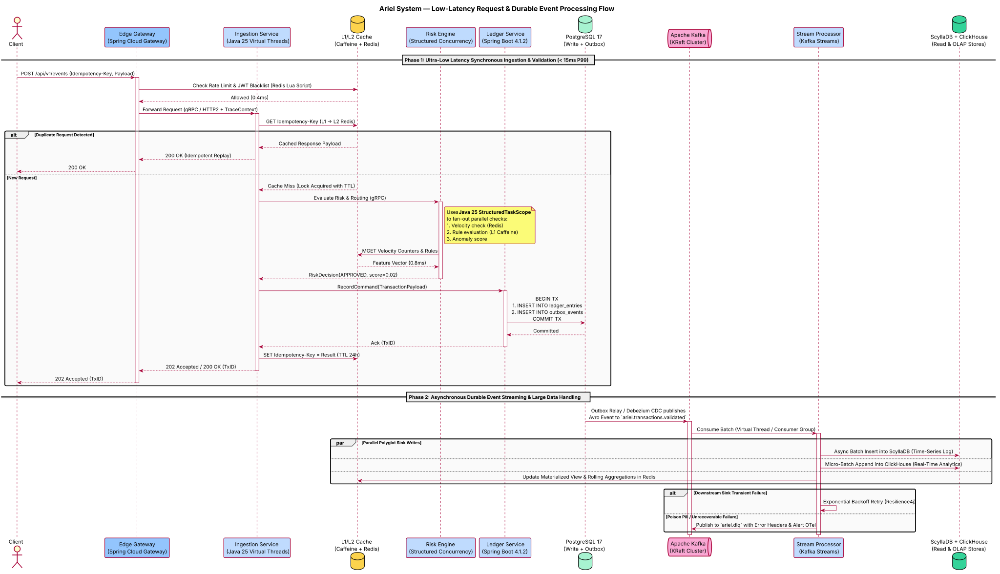

# Project Ariel — Cloud-Native High-Throughput Event, Risk & Transaction Platform

**Project Ariel** is an enterprise-grade, cloud-native distributed platform built on the modern Java stack (**Java 25**, **Spring Boot v4.1.2**, **Gradle Groovy DSL**). It is engineered to demonstrate industry best practices for **99.99%+ High Availability**, **sub-15ms P99 Fast-Path Latency**, **elastic horizontal scaling**, **durable fault tolerance**, and **petabyte-scale event/data processing**.

---

## 1. What Is This System About? (The Business & Engineering Problem)

**Project Ariel** models a **Global Real-Time Financial Transaction, Fraud/Risk Intelligence, and High-Volume Telemetry Engine**—similar to the core transaction & risk platforms behind Stripe, Adyen, or Grab/Uber.

Imagine millions of users, payment terminals, e-commerce checkouts, and IoT/partner gateways submitting financial transactions and telemetry events every second, including massive, unpredictable traffic spikes (such as Black Friday or flash sales).

For every single incoming request, the platform must solve **two fundamentally different problems simultaneously**:

1. **The Synchronous "Fast Path" (Under 15 milliseconds P99)**:
   - Verify the caller is authenticated, within their rate limit, and not sending a duplicate network retry (**Rate Limiting & Idempotency Barrier**).
   - Decide in **under 5 milliseconds** whether the transaction is fraudulent or violates tenant compliance rules (**Real-Time Risk Engine** checking account spending velocity, tenant rule graphs, and geo/amount anomalies in parallel).
   - If approved, debit/credit the account balance and record an immutable double-entry accounting record (**Transaction Ledger**) with **100% ACID accuracy and zero lost events**.
2. **The Asynchronous "Big Data & Event Path" (Millions of Events/sec)**:
   - Stream every validated transaction and raw telemetry event reliably into high-speed analytical and time-series data stores so merchants, risk analysts, and AI models can query **live dashboards, fraud trends, and billion-row historical audit logs** in sub-seconds—without ever slowing down live checkouts.

---

## 2. What Each of the 6 Microservices Does & Why It Exists

| Service | Port | Business Role | Why It Exists in the Architecture |
| :--- | :---: | :--- | :--- |
| **1. Ariel Edge Gateway** (`ariel-edge-gateway`) | `8080` | **Front Door & Traffic Shield** | Authenticates callers (OAuth2/JWT) and enforces **atomic Redis Lua token-bucket rate limiting** at the perimeter so a noisy or abusive tenant cannot overload downstream services. |
| **2. Ingestion & Command Service** (`ariel-ingestion-service`) | `8081` | **Frontline Command Coordinator** | Enforces **Idempotency-Key deduplication** (in `<1ms` via L1/L2 cache) so client retries never double-charge a customer, validates payloads, and orchestrates the synchronous `Risk Engine -> Ledger` fast path over **Java 25 Virtual Threads**. |
| **3. Real-Time Risk Engine** (`ariel-risk-engine`) | `8082` | **Instant Fraud & Rule Judge** | Blocks fraudulent or anomalous transactions *before* any money or state is committed. Uses **Java 25 Structured Concurrency (`StructuredTaskScope`)** to execute 3 checks in parallel within a strict `5ms` deadline: (1) Redis spending velocity, (2) Caffeine L1 cached tenant rules, and (3) heuristic anomaly scoring. |
| **4. Transaction Ledger Service** (`ariel-ledger-service`) | `8083` | **System of Record (Accounting)** | Authoritative owner of account balances and immutable ledger entries in **PostgreSQL 17** with `@Version` optimistic locking. Uses the **Transactional Outbox Pattern** (`outbox_events` table) so the database commit and event creation happen in one atomic ACID transaction (eliminating dual-write bugs). |
| **5. Stream Processor Service** (`ariel-stream-processor`) | `8084` | **Big Data Pipeline Worker** | Consumes events from **Apache Kafka**, groups them into micro-batches using **Java 25 Stream Gatherers (`Gatherers.windowFixed(100)`)**, and fans out parallel bulk writes to **ScyllaDB** (time-series audit log), **ClickHouse** (real-time OLAP analytics), and **Iceberg/S3** (cold lakehouse), with non-blocking retry topics and **Dead Letter Queue (`ariel.dlq`)** isolation. |
| **6. CQRS Query & Analytics Service** (`ariel-query-service`) | `8085` | **Dashboard & Reporting API** | Dedicated **CQRS Read Plane** serving live merchant summaries, fraud KPIs, and transaction history from ClickHouse, ScyllaDB, and Redis read-through cache so heavy analytical queries never compete with live transaction writes. |

---

## 3. Why Data Streaming Instead of Batch Processing?

A common architectural question is: *Why use real-time data streaming (**Apache Kafka + Stream Processor**) instead of traditional **Batch Processing** (running an hourly or nightly ETL/cron job)?*

### 3.1 The 2 Core Reasons We Need Streaming

1. **Protecting the `<15ms` Fast Write Path (Asynchronous Decoupling)**:
   - Every transaction needs to update 4 places: **PostgreSQL** (ACID ledger), **Redis** (live rolling velocity counters), **ScyllaDB** (audit/telemetry log), and **ClickHouse** (real-time analytics).
   - If the synchronous checkout API wrote to all 4 databases during the user's HTTP call, latency would balloon from **12ms to 150ms+**, and a brief slowdown in ClickHouse would cause live customer payments to fail.
   - By writing only to PostgreSQL (Ledger + Outbox) on the synchronous path and streaming the event through **Apache Kafka**, the user gets a response in `<15ms` while downstream stores are updated asynchronously within milliseconds.
2. **Acting as a Shock Absorber During 100x Traffic Spikes (Backpressure)**:
   - If traffic suddenly jumps from `5,000 req/s` to `100,000 req/s`, direct writes would overwhelm downstream analytical databases.
   - **Apache Kafka** buffers the burst safely on disk across replicated partitions while **KEDA** automatically scales out more `ariel-stream-processor` pods (`3 -> 64 pods`) based on Kafka consumer lag until the backlog is drained—**with zero dropped events**.

### 3.2 Real-Time Streaming vs. Traditional Batch Processing

Imagine a stolen card or compromised partner API key starts firing **500 fraudulent transactions per second**:

| Dimension | Traditional Batch Processing (Hourly / Nightly ETL) | Real-Time Data Streaming (Apache Kafka + Stream Processor) |
| :--- | :--- | :--- |
| **Fraud & Risk Prevention** | **Too Late**: Velocity counters and risk aggregations only update when the next batch runs (15 mins to 24 hours later). The attacker drains the account before the batch job even starts. | **Sub-Second (`<100ms`)**: Every event immediately updates rolling velocity windows in Redis & ClickHouse. Transaction #5 is automatically blocked by the Risk Engine. |
| **Database Load Pattern** | **Spiky "Batch Storms"**: Every hour or at midnight, a massive batch query scans millions of rows from PostgreSQL, spiking CPU/IO to 100% and degrading live user traffic. | **Smooth Continuous Flow**: Events stream continuously via the Outbox Relay (`FOR UPDATE SKIP LOCKED`), putting negligible load on PostgreSQL. |
| **Live Dashboards & Alerts** | **Stale Data**: Merchants and SREs looking at dashboards see metrics that are hours old. | **Real-Time Visibility**: ClickHouse and Grafana display live transaction volume, P99 risk scores, and anomaly rates within ~500ms. |
| **Failure Recovery** | **All-or-Nothing Reruns**: If a 2-hour batch job fails at 95%, teams must manually reconcile or re-run millions of records. | **Granular Replay & DLQ**: Kafka tracks exact partition offsets. If 1 poison-pill message fails, it routes to `ariel.dlq` while the other 999,999 events process uninterrupted. |

### 3.3 Combining the Best of Both Worlds: Streaming + In-Stream Micro-Batching + Cold Batch Lakehouse

Writing 1 row at a time (`event-by-event`) into columnar/wide-column stores like **ClickHouse** or **ScyllaDB** is inefficient. **Project Ariel** combines all three paradigms where each shines:
1. **Real-Time Event Streaming (`Apache Kafka`)**: Events flow continuously with millisecond latency.
2. **In-Stream Micro-Batching (`Java 25 Gatherers.windowFixed(100)`)**: Inside `ariel-stream-processor`, incoming stream events are grouped into 100-event micro-batches (or 50ms time windows) and flushed in a single bulk insert to **ScyllaDB** and **ClickHouse**—delivering **real-time freshness (`<200ms`)** *plus* **batch-level write throughput**.
3. **Cold Lakehouse Batch Processing (`Apache Iceberg on S3/MinIO`)**: For workloads that genuinely belong in batch—such as **monthly regulatory reporting, historical backfills, and training AI/ML fraud models over 6 months of history**—events are compacted into **Apache Iceberg Parquet files**, allowing batch engines to scan petabytes cheaply without touching live operational databases.

> For a detailed engineering reference, see [docs/architecture/architecture-deep-dive.md](docs/architecture/architecture-deep-dive.md) and [docs/implementation_plan.md](docs/implementation_plan.md).

---

## 4. How Cloud-Native Requirements Are Mapped to Technology

* **High Availability (`99.99%+ SLA`)**:
  * Multi-AZ active-active stateless compute pods (`topologySpreadConstraints`, `podAntiAffinity`), graceful connection draining (`server.shutdown=graceful`), PostgreSQL 17 synchronous standby (`RPO=0`), Redis 8 Cluster, and Kafka KRaft (`RF=3`, `min.insync.replicas=2`).
* **High Performance & Low Latency (`<15ms P99`)**:
  * Two-tier near-cache (**L1 Caffeine** `<100µs` + **L2 Redis 8** `<1ms`) with Redis Pub/Sub invalidation and single-flight stampede protection.
  * **Java 25 Virtual Threads**, **Structured Concurrency (`StructuredTaskScope`)**, **Scoped Values (`ScopedValue`)**, and **Generational ZGC** (`-XX:+UseZGC -XX:+ZGenerational`).
* **Durability & Resilience to Failures**:
  * **Transactional Outbox Pattern** (zero dual-write bugs), **Idempotency-Key locks**, **Resilience4j** (SemaphoreBulkhead, TimeLimiter, CircuitBreaker, Exponential Backoff with Jitter), and **Kafka Dead Letter Queues (`ariel.dlq`)**.
* **Elastic Horizontal Scaling & Massive Data**:
  * **Kubernetes HPA** (`3 -> 100+ pods` for API services) + **KEDA** (`3 -> 64 pods` for Kafka stream consumers).
  * **Polyglot Persistence**: **PostgreSQL 17** (ACID ledger) + **Redis 8** (distributed state) + **ScyllaDB** (high-write time-series) + **ClickHouse** (real-time OLAP) + **Apache Iceberg** (cold lakehouse).

---

## 5. System Architecture Diagrams (PlantUML)

All architecture diagrams are maintained as code in [`docs/architecture/`](docs/architecture/) and compiled to SVG and PNG formats:

### 5.1 Overall Cloud-Native System Architecture
- Source: [`docs/architecture/system-architecture.puml`](docs/architecture/system-architecture.puml)
- Rendered: [`docs/architecture/system-architecture.svg`](docs/architecture/system-architecture.svg) | [`docs/architecture/system-architecture.png`](docs/architecture/system-architecture.png)


### 5.2 Low-Latency Request & Durable Event Sequence Flow
- Source: [`docs/architecture/data-flow-sequence.puml`](docs/architecture/data-flow-sequence.puml)
- Rendered: [`docs/architecture/data-flow-sequence.svg`](docs/architecture/data-flow-sequence.svg) | [`docs/architecture/data-flow-sequence.png`](docs/architecture/data-flow-sequence.png)



### 5.3 Elastic Horizontal Scaling, Resilience4j & High-Availability Topology
- Source: [`docs/architecture/scaling-resilience-topology.puml`](docs/architecture/scaling-resilience-topology.puml)
- Rendered: [`docs/architecture/scaling-resilience-topology.svg`](docs/architecture/scaling-resilience-topology.svg) | [`docs/architecture/scaling-resilience-topology.png`](docs/architecture/scaling-resilience-topology.png)


---

## 6. Developer & Business Documentation Hub (Junior-to-Senior Learning Path)

Whether you are onboarding as a **Junior Developer**, understanding the business rules as a **Product/Domain Engineer**, or extending the distributed architecture as a **Senior/Staff Engineer**, start with these step-by-step guides:

| Guide | Target Audience | What You Will Learn |
| :--- | :--- | :--- |
| **[01 — Onboarding & Quick-Start Guide](docs/developer-guide/01-onboarding-and-quickstart.md)** | **All Developers (Day 1)** | Toolchain setup, repository map, running `./gradlew clean build`, starting Docker Compose & the 6 microservices, and making your first API calls. |
| **[02 — Business Domain, Invariants & Scenarios](docs/developer-guide/02-business-domain-and-scenarios.md)** | **Junior $\rightarrow$ Senior & Product** | The B2B2C financial & risk business model, domain glossary, the **4 Non-Negotiable Financial Invariants**, and **5 real-world user scenarios** traced line-by-line through the code. |
| **[03 — Java 25 & Spring Boot 4.1.2 Codebase Tour](docs/developer-guide/03-java25-springboot4-codebase-tour.md)** | **Junior $\rightarrow$ Staff Engineers** | Side-by-side comparisons of legacy Java vs. **Java 25 (`Virtual Threads`, `ScopedValue`, `StructuredTaskScope`, `Gatherers`, `sealed interface`)** and **Spring Boot 4.1.2 (`@HttpExchange`, `TwoTierNearCache`, `TransactionalOutbox`)**. |
| **[04 — Extending, Maintaining & Troubleshooting Playbook](docs/developer-guide/04-extending-and-maintaining-guide.md)** | **Mid-Level $\rightarrow$ Senior / SRE** | Cookbook recipes for adding risk checks, endpoints, zero-downtime Flyway migrations, new microservices, and troubleshooting `429`/`409`/`503`/DLQ events in production. |
| **[05 — System Design, Project Structure, Architecture & ADRs](docs/developer-guide/05-system-design-architecture-and-adrs.md)** | **All Levels (Junior $\rightarrow$ Staff)** | Capacity math (`<15ms` latency budget breakdown), why the monorepo & packages are structured this way, CQRS/Outbox/Near-Cache architecture, and **8 Architecture Decision Records (ADRs)** explaining the reasons and trade-offs for every technical choice. |
| **[Architecture Deep-Dive](docs/architecture/architecture-deep-dive.md)** | **Architects & Staff Engineers** | Deep-dive into service boundaries, streaming vs. batch trade-offs, and the polyglot persistence matrix. |
| **[Implementation Plan](docs/implementation_plan.md)** | **All Engineers** | The 4-phase technical specification and module dependency graph. |

### Quick-Start Commands
```bash
# 1. Compile all 10 modules (4 shared libs + 6 microservices) and run all JUnit 5 tests on Java 25:
./gradlew clean build

# 2. (Optional) Start PostgreSQL 17, Redis 8 (Valkey), Kafka (KRaft), ScyllaDB, and ClickHouse:
docker compose up -d

# 3. Run any microservice locally (with Generational ZGC & Virtual Threads enabled):
./gradlew :services:ariel-risk-engine:bootRun
./gradlew :services:ariel-ledger-service:bootRun
./gradlew :services:ariel-ingestion-service:bootRun
./gradlew :services:ariel-query-service:bootRun
./gradlew :services:ariel-edge-gateway:bootRun

# 4. Run the smoke & idempotency verification script:
./tests/load-test.sh
```

---

## 7. Repository & AI-Native Project Structure

This repository combines a 10-module Gradle Groovy monorepo (`libs/` + `services/`) with AI-assisted engineering customizations (`.agents/` & `AGENTS.md`):

```text
ariel-system/
├── AGENTS.md                                              # Root AI Agent Constitution & Architecture Rules
├── README.md                                              # Project Overview, Business Context & Documentation Hub
├── settings.gradle / build.gradle                         # Root Gradle 9.5 Groovy DSL Multi-Project Configuration
├── gradle/libs.versions.toml                              # Centralized Version Catalog (Spring Boot 4.1.2, Java 25)
├── buildSrc/                                              # Shared Gradle Groovy Convention Plugins
│   └── src/main/groovy/
│       ├── ariel.java25-conventions.gradle                # Java 25 toolchain, --enable-preview, ZGC, JUnit Platform
│       └── ariel.spring-boot-service.gradle               # Spring Boot 4.1.2 service conventions & actuator setup
├── libs/                                                  # Shared Platform Libraries
│   ├── ariel-common-domain/                               # Java 25 records, sealed RiskDecision, ScopedValue context
│   ├── ariel-observability-starter/                       # Auto-configured correlation filter & RFC 9457 ProblemDetails
│   ├── ariel-cache-starter/                               # L1 Caffeine + L2 Redis Near-Cache & Lua Idempotency
│   └── ariel-outbox-starter/                              # Transactional Outbox entity, publisher & Kafka relay
├── services/                                              # Cloud-Native Microservices
│   ├── ariel-edge-gateway/                                # Port 8080: API Gateway, Redis Lua Rate Limiter & Routing
│   ├── ariel-ingestion-service/                           # Port 8081: Idempotency Barrier & Fast-Path Orchestrator
│   ├── ariel-risk-engine/                                 # Port 8082: Sub-5ms Parallel StructuredTaskScope Risk Engine
│   ├── ariel-ledger-service/                              # Port 8083: ACID Balance, Ledger & Transactional Outbox
│   ├── ariel-stream-processor/                            # Port 8084: Kafka Consumer, Gatherers & Polyglot Sinks
│   └── ariel-query-service/                               # Port 8085: CQRS Read-Model Analytics & Dashboard API
├── deploy/k8s/                                            # Multi-AZ Kubernetes Deployments, HPA & KEDA Scalers
├── docker-compose.yml                                     # Local Polyglot Infrastructure (Postgres, Redis, Kafka, etc.)
├── tests/load-test.sh                                     # End-to-End Fast-Path & Idempotency Verification Script
├── .agents/                                               # AI Agents, Procedural Skills, Rules & Prompts
└── docs/
    ├── implementation_plan.md                             # Detailed 4-Phase Technical Implementation Plan
    ├── developer-guide/                                   # Junior-to-Senior Onboarding, Business & Extension Guides
    │   ├── 01-onboarding-and-quickstart.md
    │   ├── 02-business-domain-and-scenarios.md
    │   ├── 03-java25-springboot4-codebase-tour.md
    │   ├── 04-extending-and-maintaining-guide.md
    │   └── 05-system-design-architecture-and-adrs.md
    └── architecture/                                      # Architecture Deep-Dive + PlantUML (.puml/.svg/.png)
        ├── architecture-deep-dive.md
        ├── system-architecture.puml
        ├── data-flow-sequence.puml
        └── scaling-resilience-topology.puml
```
