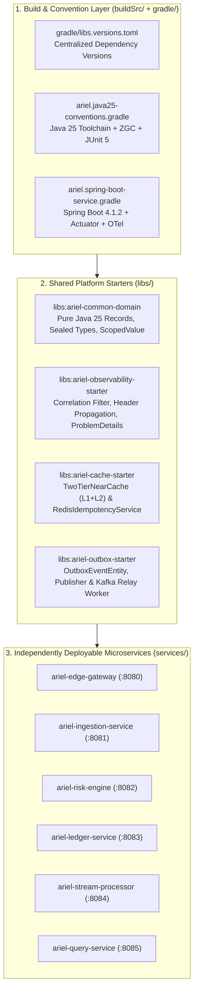

# 05 — System Design, Project Structure, Architecture & Technical Decisions (ADRs)

This document is the authoritative **System Design & Architecture Decision Record (ADR)** guide for **Project Ariel**. It explains:
1. **System Design & Capacity Engineering** (SLAs, RPS sizing, and the millisecond-by-millisecond `<15ms` latency budget)
2. **Project Structure & Module Design** (why the monorepo and packages are structured the way they are)
3. **End-to-End Architectural Patterns** (CQRS, Two-Tier Near-Cache, Outbox, Defense-in-Depth Resilience)
4. **Reasons for Every Technical Choice (ADR-001 through ADR-008)** comparing our chosen stack against industry alternatives

---

## 1. System Design & Capacity Engineering

### 1.1 Non-Functional Requirements (SLAs & SLOs)

| Metric | Target | How Ariel Achieves It |
| :--- | :--- | :--- |
| **Availability SLA** | **99.99%+** (`< 52 mins` downtime/yr) | Multi-AZ active-active stateless pods, Resilience4j circuit breakers, PostgreSQL sync standby (`RPO=0`), Redis 8 Cluster, Kafka `RF=3`. |
| **Fast-Path Write Latency** | **`< 15ms` P99** (`< 6ms` P50) | L1 Caffeine (`<100µs`) + L2 Redis (`<1ms`), Java 25 `StructuredTaskScope` parallel risk checks, single-TX Ledger + Outbox commit, Generational ZGC (`<0.5ms` GC pause). |
| **Idempotent Replay Latency** | **`< 2ms` P99** | Short-circuits at the Ingestion layer directly from L1 Caffeine / L2 Redis without calling Risk or Ledger services. |
| **Throughput Capacity** | **5,000 RPS baseline $\rightarrow$ 100,000+ RPS peak** | Stateless API pods scale `3 -> 100+` via Kubernetes HPA; Kafka buffers bursts while KEDA scales stream workers `3 -> 64`. |
| **Durability (RPO)** | **Zero Data Loss (`RPO = 0`)** | Transactional Outbox (`Propagation.MANDATORY`), PostgreSQL synchronous replication, Kafka `acks=all` + `min.insync.replicas=2` + `ariel.dlq`. |

### 1.2 The `<15ms P99` Fast-Path Latency Budget Breakdown

Why can't we just make 6 sequential network calls or write to 4 databases synchronously? Because network and disk physics dictate a strict millisecond budget:

```text
Total Synchronous P99 Budget: 15.0 ms
├── 1. Edge Gateway (TLS + Redis Lua Rate Limit Check) ............. 1.2 ms
├── 2. Gateway -> Ingestion Service HTTP/2 hop ..................... 0.8 ms
├── 3. Ingestion Idempotency Lock (L1 Caffeine / L2 Redis Lua) ..... 0.9 ms
├── 4. Risk Engine Call (Parallel StructuredTaskScope): ............ 4.5 ms
│      ├── Subtask A: Redis Velocity Counter ........ (1.2 ms) ┐
│      ├── Subtask B: L1 Caffeine Tenant Rules ...... (0.1 ms) ├─ Run in parallel! Max = ~1.5ms + network
│      └── Subtask C: Heuristic Anomaly Scorer ...... (0.3 ms) ┘
├── 5. Ledger Service ACID Commit (Balance + Entry + Outbox Row) ... 5.8 ms
├── 6. Cache Completed Receipt & Return 202 Accepted ............... 1.0 ms
└── Safety Margin / JVM ZGC headroom ............................... 0.8 ms
                                                                   ---------
                                                           Total = ~14.2 ms P99
```

> **Key Takeaway for Developers**: Notice step 4 (`Risk Engine`) and step 5 (`Ledger Service`).
> - If the 3 risk checks ran sequentially instead of using Java 25 `StructuredTaskScope`, Risk evaluation would take longer.
> - If we also wrote to ScyllaDB, ClickHouse, and Kafka synchronously during step 5, P99 latency would exceed `50–150ms`. That is why those writes happen asynchronously via the **Transactional Outbox $\rightarrow$ Kafka $\rightarrow$ Stream Processor** pipeline.

---

## 2. Project Structure & Modular Monorepo Design

### 2.1 Why a Multi-Module Monorepo (`buildSrc` + `libs` + `services`)?

Project Ariel is organized into **3 distinct layers** inside a single Gradle Groovy monorepo:



#### Why Separate `libs/*` from `services/*`?
1. **Zero Boilerplate Duplication**: Cross-cutting cloud-native mechanics—such as `ScopedValue` header propagation, RFC 9457 `ProblemDetail` error formatting, L1+L2 Near-Caching, and Transactional Outbox tables—are written **once** in `libs/*` and tested in isolation.
2. **Strict Dependency Direction**:
   - `services/*` depend on `libs/*`.
   - `libs/*` **never** depend on `services/*`.
   - No microservice ever imports another microservice's JAR (`ariel-ingestion-service` never depends on `ariel-risk-engine` code; they only share immutable DTO contracts from `libs:ariel-common-domain`).
3. **Centralized Build Governance (`buildSrc`)**: If we upgrade Spring Boot or add a JVM flag (`-XX:+UseZGC`), we change **one line** in `buildSrc/src/main/groovy/ariel.java25-conventions.gradle` or `gradle/libs.versions.toml`, and all 10 modules inherit it immediately.

### 2.2 Internal Package Structure Inside Each Microservice

Inside each service (`services/<service-name>/src/main/java/io/ariel/<service>/`), packages are separated by responsibility so any developer immediately knows where to look:

- `web/` — Inbound REST controllers (`@RestController`, request validation `@Valid`). Contains zero business logic.
- `usecase/` or `service/` — Core orchestration and business logic (`IngestionOrchestrationUseCase`, `ParallelRiskEvaluationService`, `LedgerCommandService`).
- `domain/` — Persistence entities (`@Entity`), repositories (`JpaRepository`), and domain state rules (`AccountBalanceEntity` with `@Version`).
- `client/` — Outbound declarative `@HttpExchange` interfaces and `RestClient` configurations (`FastPathClientsConfig`, `DownstreamClientsConfig`).
- `sink/` or `processor/` — Event streaming consumers (`@KafkaListener`), micro-batching (`Gatherers.windowFixed`), and polyglot storage adapters (`PolyglotAnalyticsSink`).

---

## 3. Core Architectural Patterns

### 3.1 CQRS (Command Query Responsibility Segregation)
In traditional CRUD systems, a single service and database table handle both **writes** (`INSERT`/`UPDATE`) and **complex analytical reads** (`SELECT SUM(...), AVG(...) GROUP BY ...`). Under high load, analytical table scans lock or saturate I/O on the transactional database.

In **Project Ariel**:
- **Command (Write) Side**: `Edge Gateway -> Ingestion Service -> Risk Engine -> Ledger Service (PostgreSQL 17)`. Optimized strictly for point lookups and single-row ACID inserts (`<15ms`).
- **Asynchronous Bridge**: `PostgreSQL outbox_events -> OutboxRelayWorker -> Apache Kafka -> Stream Processor`.
- **Query (Read) Side**: `Edge Gateway -> Query Service -> TwoTierNearCache (Caffeine + Redis) -> ClickHouse & ScyllaDB`. Optimized for sub-second aggregations over billions of rows.

### 3.2 Defense-in-Depth Resilience Architecture
Every request passes through multiple independent protection layers so a failure in one component never cascades into a system-wide outage:
1. **Perimeter Rate Limiting (`Edge Gateway`)**: Rejects abusive traffic surges with `HTTP 429` in `<0.5ms` via Redis Lua token buckets.
2. **Idempotency Barrier (`Ingestion Service`)**: Deduplicates client retry storms in `<1ms` before touching downstream services.
3. **Concurrency Bulkheading (`Resilience4j SemaphoreBulkhead`)**: Caps the maximum number of concurrent Virtual Threads calling the Risk Engine so a slow downstream service cannot exhaust socket pools.
4. **Deadline Cancellation (`Java 25 StructuredTaskScope`)**: Enforces a hard `50ms` timeout on parallel risk subtasks; if exceeded, child tasks are interrupted and a safe fallback (`ManualReviewRequired`) is returned.
5. **Circuit Breaking (`Resilience4j CircuitBreaker`)**: Trips `OPEN` when downstream error rates exceed threshold, failing fast with `HTTP 503` while the downstream service recovers.
6. **Poison-Pill Quarantine (`Dead Letter Queue ariel.dlq`)**: Malformed Kafka messages are routed to `ariel.dlq` so stream consumers never get stuck in an infinite crash loop.

---

## 4. Architecture Decision Records (ADRs) — Reasons for Technical Choices

Below are the 8 foundational technical decisions behind **Project Ariel**, including the alternatives we rejected and the trade-offs involved.

---

### ADR-001: Why Java 25 (Virtual Threads + `StructuredTaskScope` + `ScopedValue`) Instead of Reactive WebFlux (`Mono`/`Flux`)?
- **Context**: We need to handle 10,000+ concurrent I/O-bound requests per pod with minimal memory footprint and parallel fan-out calls.
- **Alternatives Considered**:
  1. *Traditional Thread-per-Request (Java 11/17 Platform Threads)*: Simple code, but caps out at ~400–800 concurrent requests per pod before OS thread memory and context-switching overhead degrade latency.
  2. *Reactive Programming (Spring WebFlux / Project Reactor `Mono` & `Flux`)*: Scales to high concurrency, but forces viral asynchronous return types across the entire codebase, breaks readable stack traces, makes debugging difficult for junior/mid-level developers, and is incompatible with blocking JDBC drivers.
  3. ***Chosen* — Java 25 Virtual Threads + `StructuredTaskScope` + `ScopedValue`**:
- **Reason for Choice**:
  - Delivers the **same massive I/O concurrency as Reactive WebFlux** (millions of lightweight virtual threads unmounting on I/O) while keeping **simple, readable, step-by-step imperative Java code** and clean stack traces.
  - `StructuredTaskScope` gives us safe, deadline-bounded parallel fan-out without complex `Mono.zip(...)` pipelines.
  - `ScopedValue` provides immutable, zero-leak context propagation across parent and child virtual threads.

---

### ADR-002: Why Spring Boot v4.1.2 + Declarative `@HttpExchange` (`RestClient`)?
- **Context**: Microservices (`Edge Gateway`, `Ingestion`, `Risk`, `Ledger`, `Query`) need clean, type-safe synchronous communication over HTTP/2.
- **Alternatives Considered**:
  1. *Legacy `RestTemplate`*: Verbose, maintenance-only API.
  2. *Spring Cloud OpenFeign*: Third-party dependency not natively integrated into core Spring Framework 7.
  3. *WebClient (Reactive)*: Requires `spring-webflux` and reactive wrappers.
  4. ***Chosen* — Spring Boot 4.1.2 native `@HttpExchange` backed by `RestClient` over Virtual Threads**:
- **Reason for Choice**:
  - First-class feature of Spring Framework 7 / Spring Boot 4.1.2 (`spring-boot-starter-restclient`).
  - Zero third-party library overhead; allows defining clean Java interfaces (`@PostExchange`, `@GetExchange`) while automatically sharing `ClientHttpRequestInitializer` beans for header propagation (`X-Correlation-Id`, `X-Tenant-Id`, `Idempotency-Key`) and Resilience4j decorators.

---

### ADR-003: Why Gradle 9.5 (Groovy DSL + Version Catalog + `buildSrc`) Instead of Maven?
- **Context**: Building a 10-module monorepo (`4 shared libs` + `6 services`) requires fast incremental builds and zero copy-pasted configuration.
- **Alternatives Considered**:
  1. *Apache Maven (`pom.xml`)*: Requires verbose XML repetition across 11 `pom.xml` files and slower sequential module builds.
  2. ***Chosen* — Gradle 9.5 (Groovy DSL) with `gradle/libs.versions.toml` and `buildSrc` convention plugins**:
- **Reason for Choice**:
  - Service `build.gradle` files are only **10–15 lines long** because all Java 25 compiler flags (`--enable-preview`, `-parameters`), ZGC runtime flags (`-XX:+UseZGC`), Spring Boot BOM imports, and test configurations live once in `buildSrc/src/main/groovy/ariel.java25-conventions.gradle`.
  - Gradle's task caching, incremental compilation, and parallel execution build and test all 10 modules in seconds.

---

### ADR-004: Why a Two-Tier Near-Cache (`L1 Caffeine` + `L2 Redis 8`) Instead of Redis-Only?
- **Context**: During a flash sale (`100,000 RPS`), the Risk Engine and Ingestion Service query tenant risk rules and idempotency keys on every single request.
- **Alternatives Considered**:
  1. *Database-Only*: Impossible at 100,000 RPS.
  2. *Redis-Only (L2 Only)*: Even at `0.8ms` per Redis call, 100,000 RPS generates 100,000 network round-trips/sec and heavy NIC/serialization load on the Redis cluster for identical tenant rule lookups.
  3. ***Chosen* — Two-Tier Near-Cache (`L1 Caffeine` in-pod memory + `L2 Redis 8` cluster + Redis Pub/Sub invalidation + Single-Flight Stampede Protection)**:
- **Reason for Choice**:
  - **L1 Caffeine** serves hot tenant rules and repeated idempotency hits directly from JVM heap in **`<100 microseconds`** with zero network hops, offloading 90%+ of read traffic from Redis.
  - **L2 Redis** provides shared state across all horizontally scaled pods (`<1ms`) and broadcasts invalidation events on `ariel:cache:invalidation` whenever a projection or rule changes.
  - **Single-Flight `CompletableFuture` coalescing** ensures that when a cache key expires under high concurrency, only 1 thread queries the backing store instead of causing a cache stampede.

---

### ADR-005: Why Apache Kafka (KRaft Mode) Instead of RabbitMQ or AWS SQS?
- **Context**: We need an event backbone to stream millions of validated transactions and telemetry events to multiple downstream consumers (ScyllaDB, ClickHouse, Redis, Iceberg).
- **Alternatives Considered**:
  1. *RabbitMQ / ActiveMQ*: Great for traditional point-to-point task queues, but deletes messages once consumed and degrades in throughput when persisting millions of messages/sec to disk.
  2. ***Chosen* — Apache Kafka (KRaft mode without ZooKeeper)**:
- **Reason for Choice**:
  - **Append-OnlySegmented Log**: Writes sequentially to disk at millions of events/sec with `O(1)` performance regardless of backlog size.
  - **Multi-Consumer Replay**: Multiple independent consumer groups (e.g., Stream Processor, Audit Archiver, Fraud ML Trainer) can read the same stream at their own pace and replay historical offsets.
  - **Partition-Based Horizontal Scaling**: Pairs natively with **KEDA** to autoscale `ariel-stream-processor` pods based on partition consumer lag.

---

### ADR-006: Why the Transactional Outbox Pattern Instead of Dual-Writes or Distributed 2-Phase Commit (2PC/XA)?
- **Context**: `ariel-ledger-service` must update PostgreSQL (`account_balances` + `ledger_entries`) AND publish a `ValidatedTransactionEvent` to Apache Kafka.
- **Alternatives Considered**:
  1. *Naive Dual-Write (`repo.save()` then `kafkaTemplate.send()`)*: If Kafka is temporarily unreachable or the pod crashes after the DB commit, the money moves in PostgreSQL but the Kafka event is lost forever (permanent data inconsistency).
  2. *Distributed Two-Phase Commit (2PC / XA Transactions)*: Holds long locks across both PostgreSQL and the message broker, destroying throughput and availability.
  3. ***Chosen* — Transactional Outbox Pattern (`outbox_events` table + `OutboxRelayWorker`)**:
- **Reason for Choice**:
  - Uses a **fast local PostgreSQL ACID transaction** (`Propagation.MANDATORY`) to insert both the `LedgerEntryEntity` and the `OutboxEventEntity`. Either both commit or both roll back.
  - `OutboxRelayWorker` asynchronously polls unpublished rows and delivers them to Kafka with **at-least-once** durability and zero distributed lock contention.

---

### ADR-007: Why Polyglot Persistence (`PostgreSQL 17` + `ScyllaDB` + `ClickHouse` + `Iceberg`) Instead of One Single Database?
- **Context**: No single database engine is simultaneously optimal for ACID balance locking, millions of raw time-series writes/sec, and sub-second OLAP aggregations over billions of rows.
- **Reason for Choice**:
  - **PostgreSQL 17**: Chosen for `ariel-ledger-service` because financial balances require strict ACID transactions, row-level/optimistic locking (`@Version`), and relational constraints.
  - **ScyllaDB / Apache Cassandra**: Chosen for raw telemetry & time-series audit trails (`(tenant_id, bucket_day)`) because its masterless wide-column LSM-tree architecture absorbs millions of writes/sec linearly without lock contention.
  - **ClickHouse**: Chosen for real-time tenant analytics (`ariel-query-service`) because columnar storage and vectorized SIMD execution compute `SUM`, `AVG`, and `P99` over hundreds of millions of rows in `<50ms` (100x–1000x faster than row-based PostgreSQL).
  - **Apache Iceberg (S3/MinIO)**: Chosen for multi-year compliance archival and batch ML model training at pennies per gigabyte on object storage.

---

### ADR-008: Why Dual Autoscaling (Kubernetes HPA + KEDA) Instead of CPU-Only Autoscaling?
- **Context**: Synchronous API services (`Ingestion`, `Risk`) and asynchronous Kafka consumers (`Stream Processor`) have completely different bottlenecks.
- **Reason for Choice**:
  - **Stateless API Pods (`Kubernetes HPA`)**: Scale out (`3 -> 100+ pods`) based on live **CPU, Memory, and HTTP RPS/Latency**.
  - **Kafka Consumer Pods (`KEDA`)**: An I/O-bound Kafka consumer pod may only use 25% CPU while falling behind by 500,000 messages in Kafka! CPU-only HPA would fail to scale it. **KEDA** reads **Apache Kafka Consumer Group Lag** directly (`lagThreshold: 5000`) and scales `ariel-stream-processor` from `3 -> 64` pods immediately when event backlog grows.
