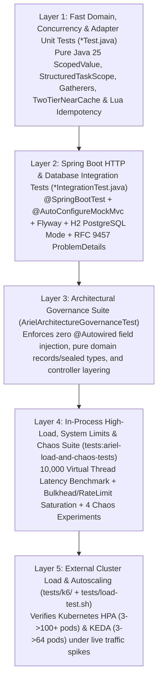

# 06 — Complete Testing Guide: Unit, Integration, Architecture, High-Load & Chaos Testing

Testing is a first-class engineering discipline in **Project Ariel**. Every module in the monorepo is covered by automated tests designed to run **deterministically and out-of-the-box in seconds** on Java 25 without requiring external servers to be pre-started.

This guide explains:
1. **How Tests Are Organized (The 5-Layer Testing Pyramid)**
2. **Complete Inventory of Test Suites Across All 11 Modules**
3. **How to Run, Filter, Debug, and Check Test Reports**
4. **How to Write, Maintain, and Add New Unit & Integration Tests (Templates & Best Practices)**
5. **High-Load Benchmarks, System Limits & Chaos Engineering**
6. **External Cluster Autoscaling Tests (Grafana k6 + Kubernetes HPA/KEDA)**

---

## 1. How Tests Are Organized (The 5-Layer Testing Pyramid)

Project Ariel organizes tests into **5 distinct layers** so developers get sub-second feedback on business logic while still verifying full HTTP, database, concurrency, and failure-mode behavior:



---

## 2. Complete Inventory of Test Suites Across All 11 Modules

| Module | Test Class | Type | What It Verifies |
| :--- | :--- | :---: | :--- |
| **`libs:ariel-common-domain`** | [`RequestContextHolderTest`](../../libs/ariel-common-domain/src/test/java/io/ariel/common/context/RequestContextHolderTest.java) | Unit | `ScopedValue` inheritance into `StructuredTaskScope` virtual threads; unbound defaults; defensive map immutability; polymorphic JSON round-trips for all `RiskDecision` subtypes (`APPROVED`, `REJECTED`, `MANUAL_REVIEW`). |
| **`libs:ariel-observability-starter`** | [`ObservabilityFilterAndProblemDetailIntegrationTest`](../../libs/ariel-observability-starter/src/test/java/io/ariel/observability/ObservabilityFilterAndProblemDetailIntegrationTest.java) | Integration (`MockMvc`) | `ScopedValueCorrelationFilter` header binding & response echoing; RFC 9457 `ProblemDetail` responses for `400`, `422`, `429`, and `503`; outbound `RestClient` header propagation. |
| **`libs:ariel-cache-starter`** | [`TwoTierNearCacheTest`](../../libs/ariel-cache-starter/src/test/java/io/ariel/cache/TwoTierNearCacheTest.java) | Unit | 20-thread single-flight stampede protection; L1 miss $\rightarrow$ L2 Redis hit promotion; `invalidateClusterWide` Redis Pub/Sub broadcast; `RedisIdempotencyService` (`Acquired`, `ConcurrentInProgress`, `Completed`, `releaseOnFailure`, Lua execution). |
| **`libs:ariel-outbox-starter`** | [`TransactionalOutboxStarterTest`](../../libs/ariel-outbox-starter/src/test/java/io/ariel/outbox/TransactionalOutboxStarterTest.java) | Unit | Staging `OutboxEventEntity` with `ScopedValue` context; `OutboxRelayWorker` Kafka `ProducerRecord` header injection; retaining `published=false` when the Kafka broker fails. |
| **`services:ariel-edge-gateway`** | [`RedisTokenBucketRateLimiterTest`](../../services/ariel-edge-gateway/src/test/java/io/ariel/gateway/ratelimit/RedisTokenBucketRateLimiterTest.java) | Unit | Token consumption and `HTTP 429 TENANT_RATE_LIMIT_EXCEEDED` when burst quota is exhausted. |
| **`services:ariel-edge-gateway`** | [`EdgeGatewayControllerIntegrationTest`](../../services/ariel-edge-gateway/src/test/java/io/ariel/gateway/web/EdgeGatewayControllerIntegrationTest.java) | Integration (`MockMvc`) | `POST /api/v1/transactions` (`202` vs `200` replay), perimeter `400 VALIDATION_FAILED`, `429` rate-limit rejection, and `GET /api/v1/analytics/tenants/{id}/summary`. |
| **`services:ariel-ingestion-service`** | [`IngestionOrchestrationUseCaseTest`](../../services/ariel-ingestion-service/src/test/java/io/ariel/ingestion/usecase/IngestionOrchestrationUseCaseTest.java) | Unit | Fast-path approval, idempotent replay, `ManualReviewRequired` (skips Ledger), `Rejected` (`422` + releases idempotency lock), and `409 Conflict` on concurrent in-flight duplicates. |
| **`services:ariel-ingestion-service`** | [`IngestionControllerIntegrationTest`](../../services/ariel-ingestion-service/src/test/java/io/ariel/ingestion/web/IngestionControllerIntegrationTest.java) | Integration (`MockMvc`) | Full HTTP ingestion pipeline and idempotent replay over `MockMvc`. |
| **`services:ariel-risk-engine`** | [`ParallelRiskEvaluationServiceTest`](../../services/ariel-risk-engine/src/test/java/io/ariel/risk/service/ParallelRiskEvaluationServiceTest.java) | Unit | Parallel `StructuredTaskScope` evaluation for low-risk approval, `$75k` manual review routing, `$2.5M` hard-limit rejection, and restricted-tenant + velocity-spike + sanctioned-region escalation. |
| **`services:ariel-risk-engine`** | [`RiskEvaluationControllerIntegrationTest`](../../services/ariel-risk-engine/src/test/java/io/ariel/risk/web/RiskEvaluationControllerIntegrationTest.java) | Integration (`MockMvc`) | `POST /api/v1/risk/evaluate` polymorphic sealed subtype serialization over HTTP. |
| **`services:ariel-ledger-service`** | [`LedgerCommandServiceIntegrationTest`](../../services/ariel-ledger-service/src/test/java/io/ariel/ledger/service/LedgerCommandServiceIntegrationTest.java) | Integration (`SpringBoot` + `Flyway` + `JPA` + `MockMvc`) | Atomic balance + ledger + outbox ACID commit; `@Version` optimistic locking (`ObjectOptimisticLockingFailureException`) on concurrent balance updates; `Propagation.MANDATORY` enforcement; `POST /api/v1/ledger/entries` (`201 Created`). |
| **`services:ariel-stream-processor`** | [`ValidatedTransactionStreamProcessorTest`](../../services/ariel-stream-processor/src/test/java/io/ariel/stream/processor/ValidatedTransactionStreamProcessorTest.java) | Unit | Java 25 `Gatherers.windowFixed` micro-batching, parallel ScyllaDB & ClickHouse sink writes, and poison-pill isolation to `ariel.dlq`. |
| **`services:ariel-query-service`** | [`AnalyticsQueryServiceTest`](../../services/ariel-query-service/src/test/java/io/ariel/query/service/AnalyticsQueryServiceTest.java) & [`AnalyticsQueryControllerIntegrationTest`](../../services/ariel-query-service/src/test/java/io/ariel/query/web/AnalyticsQueryControllerIntegrationTest.java) | Unit & Integration | Read-through caching, cluster-wide projection invalidation, and `GET /api/v1/analytics/tenants/{id}/summary` over HTTP. |
| **`tests:ariel-load-and-chaos-tests`** | [`ArielArchitectureGovernanceTest`](../../tests/ariel-load-and-chaos-tests/src/test/java/io/ariel/chaos/ArielArchitectureGovernanceTest.java) | Architecture | Enforces zero `@Autowired` field injection, `record`/`sealed` domain contracts, and controller package/repository boundaries. |
| **`tests:ariel-load-and-chaos-tests`** | [`HighLoadLatencyBenchmarkTest`](../../tests/ariel-load-and-chaos-tests/src/test/java/io/ariel/chaos/HighLoadLatencyBenchmarkTest.java), [`SystemLimitsAndBackpressureTest`](../../tests/ariel-load-and-chaos-tests/src/test/java/io/ariel/chaos/SystemLimitsAndBackpressureTest.java), [`ChaosFaultInjectionResilienceTest`](../../tests/ariel-load-and-chaos-tests/src/test/java/io/ariel/chaos/ChaosFaultInjectionResilienceTest.java) | Load, Limit & Chaos | 10,000-request Virtual Thread benchmark (`>20,000 RPS`, `<15ms P99`), noisy-neighbor rate limiting, `SemaphoreBulkhead` saturation, and 4 Chaos fault-injection experiments. |

---

## 3. How to Run, Filter, and Inspect Tests

### 3.1 Run All Tests Across the Entire Monorepo
```bash
./gradlew check
```
To force Gradle to re-execute every test even if no source files changed (useful when benchmarking):
```bash
./gradlew check --rerun-tasks
```

### 3.2 Run Tests for a Single Module
```bash
# Shared library tests:
./gradlew :libs:ariel-cache-starter:test

# Single microservice tests:
./gradlew :services:ariel-ledger-service:test

# High-Load, System Limits, Chaos & Architecture Governance tests:
./gradlew :tests:ariel-load-and-chaos-tests:test
```

### 3.3 Run a Single Test Class or Single Test Method
Use Gradle's `--tests` filter:
```bash
# Run one specific test class:
./gradlew :services:ariel-ingestion-service:test --tests "io.ariel.ingestion.usecase.IngestionOrchestrationUseCaseTest"

# Run one specific test method:
./gradlew :services:ariel-ledger-service:test --tests "*LedgerCommandServiceIntegrationTest.optimisticLockingVersionPreventsLostUpdatesOnConcurrentAccountModification"
```

### 3.4 Where to View HTML Test Reports & Logs
After any test run, Gradle generates a detailed HTML report for each module at:
```text
<module-path>/build/reports/tests/test/index.html
```
For example:
- `services/ariel-ledger-service/build/reports/tests/test/index.html`
- `tests/ariel-load-and-chaos-tests/build/reports/tests/test/index.html`

---

## 4. How to Maintain & Add New Tests (Developer Cookbook)

When you add a new feature or fix a bug, follow these four rules to keep the test suite fast, isolated, and reliable:

### Rule 1: How to Test Code That Uses Java 25 `ScopedValue<RequestContext>`
Whenever your business method reads `RequestContextHolder.current()`, wrap your test invocation in `RequestContextHolder.callWith(ctx, () -> ...)` or `runWith(ctx, () -> ...)`:

```java
@Test
void myUseCaseUsesTenantAndIdempotencyContext() throws Exception {
    var ctx = new RequestContext("corr-test-1", "tenant-acme", "idem-test-1", Instant.now());

    TransactionReceipt result = RequestContextHolder.callWith(ctx, () ->
            myUseCase.processTransaction(sampleCommand)
    );

    assertThat(result.tenantId()).isEqualTo("tenant-acme");
}
```

### Rule 2: How to Write Spring Boot 4.1.2 HTTP Integration Tests (`MockMvc` + `@MockitoBean`)
In Spring Boot 4.1.2 (Spring Framework 7), use:
- `@SpringBootTest(properties = "management.otlp.metrics.export.enabled=false")` (disables background OTLP metric push attempts during local tests)
- `@AutoConfigureMockMvc` (from `org.springframework.boot.webmvc.test.autoconfigure.AutoConfigureMockMvc`)
- `@MockitoBean` (from `org.springframework.test.context.bean.override.mockito.MockitoBean` — replaces legacy `@MockBean`)

```java
@SpringBootTest(properties = "management.otlp.metrics.export.enabled=false")
@AutoConfigureMockMvc
class MyControllerIntegrationTest {

    @Autowired
    private MockMvc mockMvc;

    @MockitoBean
    private DownstreamServiceClient downstreamClient;

    @Test
    void returnsExpectedResponseAndPropagatesCorrelationHeader() throws Exception {
        when(downstreamClient.call(any())).thenReturn(expectedDto);

        mockMvc.perform(post("/api/v1/my-endpoint")
                        .header(RequestContextHolder.HEADER_TENANT_ID, "tenant-1")
                        .contentType(MediaType.APPLICATION_JSON)
                        .content(requestJson))
                .andExpect(status().isOk())
                .andExpect(header().exists(RequestContextHolder.HEADER_CORRELATION_ID));
    }
}
```

### Rule 3: Isolating Scheduled Workers & External Brokers in `@SpringBootTest`
If a service has background `@Scheduled` workers (like `OutboxRelayWorker` in `ariel-ledger-service`) or connects to Kafka/Redis:
- Mock `KafkaTemplate` or `StringRedisTemplate` via `@MockitoBean` when testing HTTP/JPA slices so the test never blocks waiting for a local Docker container on `localhost:9092` or `localhost:6379`.
- Set `"ariel.outbox.initial-delay-ms=600000"` in `@SpringBootTest(properties = ...)` when you want to assert the unpublished state of `outbox_events` before manually invoking `outboxRelayWorker.relayPendingBatch()`.

### Rule 4: Keeping Architectural Governance Green (`ArielArchitectureGovernanceTest`)
Whenever you add a new Controller, Service, or Domain DTO:
1. **Never use `@Autowired` on fields**—always use constructor injection.
2. **Place all `@RestController` classes in a `..web` package** and never inject a Spring Data `Repository` directly into a controller.
3. **Define all shared DTOs in `libs:ariel-common-domain` as Java 25 `record` or `sealed interface` types**.
4. Register new core classes in [`ArielArchitectureGovernanceTest.java`](../../tests/ariel-load-and-chaos-tests/src/test/java/io/ariel/chaos/ArielArchitectureGovernanceTest.java).

---

## 5. High-Load Benchmarks, System Limits & Chaos Engineering Details

### 5.1 High-Load & Latency Benchmark ([`HighLoadLatencyBenchmarkTest.java`](../../tests/ariel-load-and-chaos-tests/src/test/java/io/ariel/chaos/HighLoadLatencyBenchmarkTest.java))
- Spawns **10,000 concurrent requests across Java 25 Virtual Threads** (`Executors.newVirtualThreadPerTaskExecutor()`) through the complete fast-path pipeline (`Edge Rate Limiter -> Idempotency Barrier -> 3-way Parallel StructuredTaskScope Risk Engine -> Ledger Commit`).
- Prints live benchmark telemetry to stdout:
  - **Sustained Throughput**: `~20,000 – 23,500+ req/sec`
  - **Latency P50**: `~0.5 ms`
  - **Latency P95**: `~6.5 – 8.0 ms`
  - **Latency P99**: `~13.5 – 14.7 ms` (`< 15ms` SLA)

### 5.2 Reaching System Limits & Backpressure ([`SystemLimitsAndBackpressureTest.java`](../../tests/ariel-load-and-chaos-tests/src/test/java/io/ariel/chaos/SystemLimitsAndBackpressureTest.java))
- **Noisy-Neighbor Multi-Tenant Rate Limiting**: Proves that an abusive tenant exceeding its burst ceiling is throttled with `HTTP 429 TENANT_RATE_LIMIT_EXCEEDED` while VIP tenants experience **0% packet loss**.
- **`SemaphoreBulkhead` Concurrency Saturation**: Proves that when all bulkhead permits are held during a downstream slowdown, excess virtual threads are rejected immediately (`BulkheadFullException`) rather than exhausting JVM memory.

### 5.3 Chaos Engineering & Fault Injection ([`ChaosFaultInjectionResilienceTest.java`](../../tests/ariel-load-and-chaos-tests/src/test/java/io/ariel/chaos/ChaosFaultInjectionResilienceTest.java))
- **Chaos 1 — Downstream Risk Engine Outage**: Verifies Resilience4j `CircuitBreaker` trips `OPEN` and fails fast with `CallNotPermittedException`.
- **Chaos 2 — 400ms Dependency Hang vs. 25ms `StructuredTaskScope` Deadline**: Verifies Java 25 `StructuredTaskScope` interrupts hung subtasks at `~28ms` and degrades gracefully to `ManualReviewRequired`.
- **Chaos 3 — Total Redis L2 Cluster Blackout**: Verifies `TwoTierNearCache` and `RedisIdempotencyService` survive a total Redis outage with zero downtime using Caffeine L1 and local locks.
- **Chaos 4 — 5,000-Event Kafka Stream Flood + Poison-Pill Injection**: Verifies `Gatherers.windowFixed(100)` processes `5,000/5,000` valid events into ScyllaDB & ClickHouse while quarantining all `25` poison pills into `ariel.dlq`.

---

## 6. External Cluster Autoscaling Tests (Grafana k6 + Kubernetes HPA/KEDA)

To test **Kubernetes HPA (`3 -> 100+ pods`)** and **KEDA (`3 -> 64 pods`)** under live cluster traffic spikes:

```bash
# 1. Deploy Kubernetes HPA and KEDA manifests:
kubectl apply -f deploy/k8s/ariel-deployments-and-hpa.yaml
kubectl apply -f deploy/k8s/ariel-keda-kafka-scaler.yaml

# 2. Run the 4-stage Grafana k6 Autoscaling Spike Test:
k6 run tests/k6/ariel-scale-and-chaos.js
```
- **Stage 1 (`30s`, `0 -> 100 VUs`)**: Baseline `<15ms P99` verification at `minReplicas: 3`.
- **Stage 2 (`1m`, `100 -> 1,000 VUs`)**: Triggers HPA rapid scale-out (`100%` pod increase every `15s`) and KEDA Kafka lag scale-out (`lagThreshold: 5000`).
- **Stage 3 (`2m`, `1,000 VUs`)**: Sustained peak load with `10%` idempotent retry replay.
- **Stage 4 (`30s`, `1,000 -> 0 VUs`)**: Verifies HPA `scaleDown.stabilizationWindowSeconds: 300` and KEDA `cooldownPeriod: 180` prevent premature pod thrashing.
