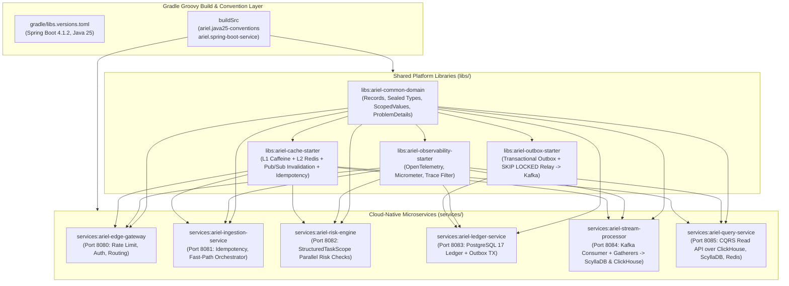

# Implementation Plan — Project Ariel: Cloud-Native Real-Time Event, Risk & Transaction Platform

## Goal Description

Implement **Project Ariel** end-to-end as a production-grade, cloud-native distributed system built on **Java 25**, **Spring Boot v4.1.2**, and **Gradle 9.5 (Groovy DSL)**.

The system demonstrates industry best practices for:
- **High Availability (99.99%+ SLA)** & **Ultra-Low Latency (<15ms P99 Fast Path)** using **Java 25 Virtual Threads**, **Structured Concurrency (`StructuredTaskScope`)**, **Scoped Values (`ScopedValue`)**, **Stream Gatherers (`Gatherers`)**, and **Generational ZGC** (`-XX:+UseZGC -XX:+ZGenerational`).
- **Two-Tier Near-Cache (`L1 Caffeine` + `L2 Redis 8 Cluster`)** with Redis Pub/Sub invalidation across horizontally scaled pods, single-flight stampede protection, and atomic Lua-based **Idempotency-Key** barriers.
- **Durable Event Streaming (`Apache Kafka KRaft`) & Zero Dual-Write (`Transactional Outbox Pattern`)** with non-blocking retries and Dead Letter Queue (`ariel.dlq`) routing.
- **Massive Data & Polyglot Persistence**:
  - **PostgreSQL 17**: ACID transactional ledger & outbox store (Flyway migrations).
  - **Redis 8 / Valkey**: Distributed L2 cache, velocity counters, idempotency locks, and token-bucket rate limiting.
  - **ScyllaDB / Apache Cassandra**: Wide-column high-velocity raw telemetry & time-series store.
  - **ClickHouse**: Columnar real-time OLAP store for sub-second analytical aggregations over billions of events.
- **Elastic Horizontal Scaling & Fault Tolerance**: **Resilience4j** (CircuitBreaker, SemaphoreBulkhead, TimeLimiter, RateLimiter, Retry with Jitter), **Spring Boot 4 OpenTelemetry & Micrometer Prometheus**, **Docker Compose** local cloud stack, and **Kubernetes HPA + KEDA** manifests.

---

## User Review Required

> [!IMPORTANT]
> **Aligned Architectural Decisions**:
> 1. **Full 4-Phase Scope**: We will build the complete multi-module Gradle Groovy monorepo including `buildSrc` conventions, 4 shared library starters (`libs/*`), all 6 microservices (`services/*`), local `docker-compose.yml` infrastructure, Kubernetes/KEDA manifests (`deploy/k8s/*`), and automated tests.
> 2. **Synchronous Inter-Service Protocol**: Internal fast-path calls (`Edge Gateway -> Ingestion -> Risk Engine & Ledger`) will use **Spring Boot 4.1.2 Declarative HTTP Interfaces (`@HttpExchange`) backed by `RestClient` over Virtual Threads**, protected by Resilience4j decorators and W3C TraceContext propagation.
> 3. **Java 25 Preview/Final APIs**: Since `StructuredTaskScope` (JEP 499 / 505) and `ScopedValue` (JEP 487 / 506) require `--enable-preview` on OpenJDK 25 depending on final/preview status in `25.0.3`, our Gradle Groovy convention plugin will configure `--enable-preview` cleanly across `JavaCompile`, `Test`, and `JavaExec` tasks so all modern Java 25 concurrency APIs work seamlessly.

---

## System Module & Dependency Architecture



---

## Proposed Changes

### Component 1: Gradle Groovy Monorepo & Convention Plugins (Phase 1A)

Set up the root Gradle 9.5 Groovy DSL build, centralized version catalog (`gradle/libs.versions.toml`), and `buildSrc` convention plugins enforcing Java 25 and Spring Boot 4.1.2 standards.

#### [NEW] [settings.gradle](file:///home/boris/devspace/ariel-system/settings.gradle)
- Defines `rootProject.name = 'ariel-system'` and includes all 4 shared libraries and 6 microservices:
  - `libs:ariel-common-domain`
  - `libs:ariel-observability-starter`
  - `libs:ariel-cache-starter`
  - `libs:ariel-outbox-starter`
  - `services:ariel-edge-gateway`
  - `services:ariel-ingestion-service`
  - `services:ariel-risk-engine`
  - `services:ariel-ledger-service`
  - `services:ariel-stream-processor`
  - `services:ariel-query-service`

#### [NEW] [gradle/libs.versions.toml](file:///home/boris/devspace/ariel-system/gradle/libs.versions.toml)
- Centralizes versions:
  - `springBoot = "4.1.2"`
  - `springDependencyManagement = "1.1.7"`
  - `resilience4j = "2.3.0"`
  - `caffeine = "3.2.0"`
  - `clickhouseJdbc = "0.7.2"`
  - `archunit = "1.4.0"`
- Declares Spring Boot 4.1.2 starters (`spring-boot-starter-webmvc`, `spring-boot-starter-restclient`, `spring-boot-starter-actuator`, `spring-boot-starter-validation`, `spring-boot-starter-data-jpa`, `spring-boot-starter-flyway`, `spring-boot-starter-data-redis`, `spring-boot-starter-data-cassandra`, `spring-boot-starter-kafka`, `spring-boot-starter-opentelemetry`, `spring-boot-starter-micrometer-metrics`, `spring-boot-starter-test`, `spring-boot-testcontainers`).

#### [NEW] [build.gradle](file:///home/boris/devspace/ariel-system/build.gradle)
- Root Groovy build file configuring group `io.ariel`, version `1.0.0-SNAPSHOT`, and common repository policies.

#### [NEW] [buildSrc/build.gradle](file:///home/boris/devspace/ariel-system/buildSrc/build.gradle)
- Applies `groovy-gradle-plugin` and links Spring Boot `4.1.2` gradle plugin for reusable convention plugins.

#### [NEW] [buildSrc/src/main/groovy/ariel.java25-conventions.gradle](file:///home/boris/devspace/ariel-system/buildSrc/src/main/groovy/ariel.java25-conventions.gradle)
- Configures `JavaLanguageVersion.of(25)` toolchain, UTF-8 encoding, `-parameters`, `--enable-preview`, and JUnit Platform with `-XX:+UseZGC -XX:+ZGenerational`.

#### [NEW] [buildSrc/src/main/groovy/ariel.spring-boot-service.gradle](file:///home/boris/devspace/ariel-system/buildSrc/src/main/groovy/ariel.spring-boot-service.gradle)
- Extends `ariel.java25-conventions`, applies `org.springframework.boot`, configures `bootRun` and `bootJar` with Generational ZGC and CDS/AOT flags, and wires common observability and testing dependencies.

---

### Component 2: Shared Platform Libraries (`libs/*`) (Phase 1B)

Build the reusable building blocks shared across all microservices.

#### [NEW] [libs/ariel-common-domain/build.gradle](file:///home/boris/devspace/ariel-system/libs/ariel-common-domain/build.gradle)
- Pure Java 25 domain primitives and contracts:
  - `io.ariel.common.context.RequestContext` (Java 25 `record` holding `correlationId`, `tenantId`, `idempotencyKey`, `receivedAt`) and `RequestContextHolder` using **Java 25 `ScopedValue<RequestContext>`**.
  - `io.ariel.common.domain.TransactionCommand`, `RiskEvaluationRequest`, `RiskDecision` (`sealed interface` with `Approved`, `Rejected`, `ManualReviewRequired` records), `LedgerEntryDto`, `TelemetryEventPayload`, `AnalyticsSummaryDto`.
  - `io.ariel.common.error.ArielBusinessException` & standardized RFC 9457 `ProblemDetail` factory utilities.

#### [NEW] [libs/ariel-observability-starter/build.gradle](file:///home/boris/devspace/ariel-system/libs/ariel-observability-starter/build.gradle)
- Auto-configured Spring Boot starter (`META-INF/spring/org.springframework.boot.autoconfigure.AutoConfiguration.imports`):
  - `ScopedValueCorrelationFilter`: Binds incoming `X-Correlation-Id`, `X-Tenant-Id`, and `Idempotency-Key` headers into `RequestContextHolder.CONTEXT` via `ScopedValue.where(...).run(...)` for every Virtual Thread HTTP request, and propagates headers on outgoing `RestClient` calls.
  - `GlobalProblemDetailExceptionHandler`: `@RestControllerAdvice` translating validation errors, circuit breaker open exceptions, rate limit rejections, and domain errors into RFC 9457 `ProblemDetail` responses with trace IDs.

#### [NEW] [libs/ariel-cache-starter/build.gradle](file:///home/boris/devspace/ariel-system/libs/ariel-cache-starter/build.gradle)
- Multi-tier near-cache and idempotency engine:
  - `TwoTierNearCache<V>`: Combines **L1 Caffeine** (`maximumSize=50_000`, `expireAfterWrite=30s`, recordStats) + **L2 Redis (`StringRedisTemplate`)** + in-flight `ConcurrentHashMap<String, CompletableFuture<V>>` single-flight coalescing to prevent cache stampedes.
  - `CacheInvalidationPubSub`: Broadcasts key evictions over Redis channel `ariel:cache:invalidation` so all horizontally scaled pods immediately evict stale L1 keys.
  - `RedisIdempotencyService`: Atomic Lua script (`SET key IN_PROGRESS NX EX 60` -> stores completed response payload for 24h) preventing duplicate command execution under concurrent retries.

#### [NEW] [libs/ariel-outbox-starter/build.gradle](file:///home/boris/devspace/ariel-system/libs/ariel-outbox-starter/build.gradle)
- Zero dual-write Transactional Outbox infrastructure:
  - `OutboxEventEntity` & `OutboxRepository` (using PostgreSQL `FOR UPDATE SKIP LOCKED` batch polling for concurrent pod safety).
  - `TransactionalOutboxPublisher`: Persists serialized event payloads inside the caller's active database transaction.
  - `OutboxRelayScheduler`: Polls unpublished outbox rows in micro-batches, publishes asynchronously to Apache Kafka with `acks=all` and W3C trace headers, and marks rows published.

---

### Component 3: Synchronous Fast-Path Microservices (`services/*`) (Phase 2)

Implement the 4 microservices powering the `<15ms P99` synchronous request flow.

#### [NEW] [services/ariel-edge-gateway/build.gradle](file:///home/boris/devspace/ariel-system/services/ariel-edge-gateway/build.gradle)
- **Ariel Edge Gateway (`port 8080`)**:
  - `RedisTokenBucketRateLimiter`: Executes an atomic Redis Lua token-bucket script per `tenantId` / client IP (`X-RateLimit-Remaining` headers, HTTP `429 Too Many Requests` RFC 9457 ProblemDetail on burst exhaustion).
  - `EdgeGatewayController`: Routes `/api/v1/events/**` and `/api/v1/transactions/**` to `ariel-ingestion-service` and `/api/v1/analytics/**` to `ariel-query-service` via Virtual Thread HTTP/2 `RestClient` wrapped in Resilience4j CircuitBreaker and TimeLimiter.

#### [NEW] [services/ariel-ingestion-service/build.gradle](file:///home/boris/devspace/ariel-system/services/ariel-ingestion-service/build.gradle)
- **Ariel Ingestion & Command Service (`port 8081`)**:
  - Declarative HTTP clients (`@HttpExchange`) for `RiskEngineClient` and `LedgerServiceClient`.
  - `IngestionOrchestrationUseCase`:
    1. Checks `Idempotency-Key` via `TwoTierNearCache` + `RedisIdempotencyService`.
    2. Invokes `RiskEngineClient.evaluate(...)` protected by Resilience4j `@CircuitBreaker`, `@Bulkhead`, and `@Retry`.
    3. Uses Java 25 exhaustive pattern matching `switch (decision)` on `RiskDecision` (`Approved`, `Rejected`, `ManualReviewRequired`).
    4. For approved transactions, calls `LedgerServiceClient.recordTransaction(...)`, caches the idempotent result, and returns `202 Accepted` with latency telemetry.

#### [NEW] [services/ariel-risk-engine/build.gradle](file:///home/boris/devspace/ariel-system/services/ariel-risk-engine/build.gradle)
- **Ariel Real-Time Risk Engine (`port 8082`)**:
  - `ParallelRiskEvaluationService`: Uses **Java 25 `StructuredTaskScope.ShutdownOnFailure`** (inheriting `ScopedValue` context automatically across child virtual threads) to execute 3 checks concurrently within a strict deadline:
    1. **Velocity Check**: Atomic Redis counter increment/lookup (`INCRBYFLOAT` / sliding window per account).
    2. **Tenant Rule Graph Evaluation**: Loaded from **L1 Caffeine + L2 Redis TwoTierNearCache** (`<100µs`).
    3. **Heuristic Anomaly Scorer**: Evaluates payload amount, geo-velocity, and device fingerprint patterns.
  - Combines the 3 parallel sub-task results into a sealed `RiskDecision` outcome.

#### [NEW] [services/ariel-ledger-service/build.gradle](file:///home/boris/devspace/ariel-system/services/ariel-ledger-service/build.gradle)
- **Ariel Transaction Ledger Service (`port 8083`)**:
  - Backed by **PostgreSQL 17** with **Flyway** migration `V1__init_ledger_and_outbox.sql` creating `ledger_entries`, `account_balances` (with `@Version` optimistic locking), and `outbox_events` (indexed for `SKIP LOCKED` relay).
  - `LedgerCommandService`: Executes `@Transactional` write updating the account balance, inserting the immutable `LedgerEntry`, and recording a `TransactionValidatedEvent` in `outbox_events` in a single ACID commit.

---

### Component 4: Event Streaming & Polyglot Big Data Plane (`services/*`) (Phase 3)

Implement the high-throughput Kafka stream processor and CQRS analytical read service over ScyllaDB, ClickHouse, and Redis.

#### [NEW] [services/ariel-stream-processor/build.gradle](file:///home/boris/devspace/ariel-system/services/ariel-stream-processor/build.gradle)
- **Ariel Stream Processor (`port 8084`)**:
  - Consumes batches from Kafka topic `ariel.transactions.validated` with non-blocking retry topics and Dead Letter Queue (`ariel.dlq`) publishing on poison-pill failures.
  - Uses **Java 25 `Stream.gather(Gatherers.windowFixed(100))`** to partition incoming event batches into micro-batches and uses `StructuredTaskScope` to fan out writes in parallel to:
    1. **ScyllaDB / Cassandra (`RawTelemetrySink`)**: High-velocity wide-column table `ariel_telemetry.events_by_tenant_day` keyed by `((tenant_id, bucket_day), event_time, tx_id)`.
    2. **ClickHouse (`ClickHouseAnalyticsSink`)**: High-speed batch insert into `MergeTree` table `ariel_analytics.transaction_events` for real-time OLAP queries.
    3. **Redis (`RealtimeMetricsAggregator`)**: Updates live rolling window volume & count metrics and publishes cache invalidation notices.

#### [NEW] [services/ariel-query-service/build.gradle](file:///home/boris/devspace/ariel-system/services/ariel-query-service/build.gradle)
- **Ariel CQRS Query & Analytics Service (`port 8085`)**:
  - Serves low-latency read endpoints backed by `TwoTierNearCache`:
    - `GET /api/v1/analytics/tenants/{tenantId}/summary`: Queries ClickHouse real-time OLAP aggregations (total volume, P95/P99 risk scores, approved/rejected counts) cached in L1/L2.
    - `GET /api/v1/analytics/tenants/{tenantId}/telemetry`: Queries ScyllaDB/Cassandra time-series history by `(tenant_id, bucket_day)`.
    - `GET /api/v1/transactions/{txId}`: Point-in-time transaction lookup.

---

### Component 5: Cloud-Native Infrastructure, Kubernetes HPA/KEDA & Load Testing (Phase 4)

Provide turnkey local Docker Compose orchestration, Kubernetes production manifests, and automated load/resilience verification.

#### [NEW] [docker-compose.yml](file:///home/boris/devspace/ariel-system/docker-compose.yml)
- Configures the complete local polyglot infrastructure with healthchecks:
  - `postgres:17-alpine` (Port 5432)
  - `redis:8.0-M03-alpine` / `valkey/valkey:8.0-alpine` (Port 6379)
  - `apache/kafka:3.9.0` in KRaft mode (Port 9092)
  - `scylladb/scylla:6.2` (Port 9042)
  - `clickhouse/clickhouse-server:24.8-alpine` (Port 8123 / 9000)
  - `otel/opentelemetry-collector-contrib` + `prom/prometheus` + `grafana/grafana`

#### [NEW] [deploy/k8s/ariel-deployments-and-hpa.yaml](file:///home/boris/devspace/ariel-system/deploy/k8s/ariel-deployments-and-hpa.yaml)
- Multi-AZ Kubernetes `Deployment` manifests (with `topologySpreadConstraints`, readiness/liveness/startup probes, graceful preStop hooks, and `-XX:+UseZGC -XX:+ZGenerational` JVM flags) plus `HorizontalPodAutoscaler` (`minReplicas: 3`, `maxReplicas: 100`) for stateless API services.

#### [NEW] [deploy/k8s/ariel-keda-kafka-scaler.yaml](file:///home/boris/devspace/ariel-system/deploy/k8s/ariel-keda-kafka-scaler.yaml)
- KEDA `ScaledObject` scaling `ariel-stream-processor` from `3` to `64` pods dynamically based on Apache Kafka consumer lag on `ariel.transactions.validated`.

#### [NEW] [tests/load-test.sh](file:///home/boris/devspace/ariel-system/tests/load-test.sh)
- High-concurrency load & idempotency benchmark script verifying throughput, duplicate request suppression, and P99 latency.

---

## Verification Plan

### Automated Build & Test Suite
We will verify every module and architectural boundary using Gradle 9.5 on Java 25:

1. **Full Monorepo Compilation & Unit/Integration Tests**:
   ```bash
   ./gradlew clean build
   ```
   - Verifies Java 25 compilation across all 10 modules (`4 libs` + `6 services`).
   - Runs unit and slice/integration tests verifying:
     - **Java 25 `ScopedValue` & `StructuredTaskScope`** parallel risk evaluation and deadline cancellation in `ariel-risk-engine`.
     - **Two-Tier Near-Cache (`L1 Caffeine` + `L2 Redis` + Pub/Sub invalidation)** and **Idempotency-Key deduplication** in `ariel-cache-starter` and `ariel-ingestion-service`.
     - **Transactional Outbox ACID persistence & relay** in `ariel-ledger-service`.
     - **Java 25 Stream `Gatherers.windowFixed` micro-batching & DLQ routing** in `ariel-stream-processor`.
     - **ArchUnit** hexagonal architecture rules across services.

2. **PlantUML Diagram Verification**:
   ```bash
   plantuml -tsvg -tpng docs/architecture/*.puml
   ```

### Manual Verification
- Start the local infrastructure (`docker compose up -d`), run the services via `./gradlew :services:<service>:bootRun`, and execute `tests/load-test.sh` to inspect live responses, RFC 9457 `ProblemDetail` payloads, and Prometheus/OpenTelemetry metrics at `/actuator/prometheus`.
